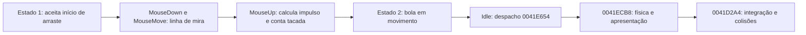

# Eventos e caminho de uma tacada

**Errata posterior:** a descrição inicial de divisão por sqrt(L)/0,4 abaixo estava incorreta. A [etapa 20](20-correcao-da-curva-de-tacada.md) confirma multiplicação por sqrt(L) e 0,1, com resposta L^1,5. A seção histórica foi preservada; usar a especificação 13 corrigida na implementação.

Investigação de 2026-10-28, continuação do reconhecimento. Prioridade definida pelo usuário: reconstrução moderna com física semelhante, sem necessidade de reproduzir bugs. .NET/raylib são possibilidades futuras; nenhuma decisão de engine ou implementação foi tomada.

## Evidência e método

Acesso ao mesmo WiniGolf.exe confirmado pelo GhidraMCP, com o mesmo SHA-256 registrado no reconhecimento. Foram usados leitura de memória, referências cruzadas, decompilação e disassembly de funções já definidas. Também foi feita leitura local do PE para localizar strings em recursos e conferir constantes IEEE-754. Nenhuma ferramenta de mutação do Ghidra foi chamada.

Há uma limitação importante do banco atual: os três handlers de mouse e a rotina de idle **não estão definidos como funções**. `decompile_function_by_address` retorna `FUNCTION_NOT_FOUND` para esses endereços. Isso explica a referência com `caller: null` vista anteriormente. A identificação abaixo usa tabelas reais, recursos e leitura manual dos bytes x86; não foram criadas funções no banco para contornar a limitação.

Evidências brutas: [eventos-fisica-ghidra.json](evidencias/eventos-fisica-ghidra.json). Pseudocódigo de física e despacho também consta em [reconhecimento-ghidra.json](evidencias/reconhecimento-ghidra.json). Nomes de eventos abaixo são nomes originais; nomes de variáveis na explicação são convenções documentais.

## Eventos confirmados

A tabela em `0x004906F1` começa com contagem 23 e registros com tamanho, ponteiro de código e nome curto. Contém:

| Método original | Endereço | Confiança |
| --- | --- | --- |
| FormMouseDown | `0x0041DB20` | Alta |
| FormMouseMove | `0x0041DCB4` | Alta |
| FormMouseUp | `0x0041DF0C` | Alta |
| FormCreate | `0x004018C0` | Alta; confirma hipótese anterior |
| StartClick | `0x004213CC` | Alta no vínculo; corpo ainda não analisado |
| StopClick | `0x004215F4` | Alta no vínculo; corpo ainda não analisado |
| FormPaint | `0x00421E2C` | Alta no vínculo |
| FormActivate | `0x00423D40` | Alta no vínculo |

O recurso de formulário em torno de `0x004C5900` vincula explicitamente OnCreate→FormCreate, OnMouseDown→FormMouseDown, OnMouseMove→FormMouseMove, OnMouseUp→FormMouseUp e OnPaint→FormPaint. Portanto, aqui há confirmação de ligação dos eventos, além de nomes soltos no RTTI. O campo da VMT em `0x00490454` aponta para a tabela de métodos.

## Idle em vez de timer explícito

**Confiança alta:** o construtor em `0x004015CC` grava o par método/objeto (`0x0041D78C`, this) nos offsets `+0xE8/+0xEC` do objeto de aplicação acessado por `PTR_DAT_004979EC`. A rotina escreve zero no booleano recebido em ECX, consulta GetTickCount pelo thunk `0x0048CFEA` e chama `0x0041E654`. O conjunto é compatível com o callback VCL OnIdle (**confiança média/alta no nome da propriedade**, pois não foi reconstruído o tipo completo da aplicação).

Leitura dos bytes em `0x0041D78C–0x0041D7EF`:

```text
done = false
t = GetTickCount()
bucket = divisão inteira assinada de t por 20
delta = bucket - bucketAnterior
se delta != 0:
    bucketAnterior = bucket
    executar laço de contagem sem chamadas de atualização
    chamar 0x0041E654 uma vez
```

O laço contém comparação com 10, mas **não contém chamada à física**. Não há sustentação para afirmar que recupera dez passos atrasados: a chamada em `0x0041D7E8` está depois dele. Em condições normais, o gate nominal é de 20 ms, aproximadamente 50 atualizações/s; sob atraso, o trecho observado não recupera os passos perdidos. Não foi medida a frequência real em execução. A divisão assinada e o wrap de GetTickCount são detalhes legados dispensáveis para uma reconstrução.

## Do mouse à bola em movimento

**FormMouseDown — confiança alta nas condições e escritas:** exige estado `objeto+0xC8674 == 1` e flag de arraste `+0xC8640 == 0`. Verifica uma região em torno das coordenadas de tela `+0xC824C/+0xC8250`, com constantes 15, 25 e 10 em `0x0041DCA4–0x0041DCAC`. Para Button 0 ou 1, ativa a flag e seleciona modo 1 ou 2 em `+0xC8644`. Isso corresponde provavelmente aos botões esquerdo/direito da enumeração VCL; o ordinal é confirmado, a interpretação humana tem confiança média/alta. Inicializa uma âncora de tela em `+0xC8630/+0xC8634`, com deslocamento vertical de 7, e salva o ponto corrente em `+0xC8638/+0xC863C`.

**FormMouseMove — confiança alta no mecanismo geral:** com arraste ativo, apaga/redesenha uma linha e atualiza a ponta do arraste. Calcula comprimento euclidiano; limita a distância a 250 pixels no modo 1 ou 50 no modo 2. O cálculo de limite usa ângulo e funções trigonométricas para manter a direção, seguido de conversão para inteiro. A linha funciona como indicação da tacada. Não usa duração do arraste para calcular força no trecho lido.

**FormMouseUp — confiança alta no fluxo:** se há arraste ativo, zera o contador `+0xCDBD0`, grava estado 2, toca `Hit` quando som está habilitado e mostra `Ball in play...`. Obtém o vetor a partir dos pontos de arraste armazenados, transforma-o para componentes da velocidade em `+0xC8234/+0xC8238`, atualiza contagem de tacadas/painéis e termina desativando o arraste. O estado 2 de `0x0041E654` chama `0x0041ECB8`, que chama a física `0x0041D2A4`.

Constantes verificadas na conversão de impulso:

- Modo 1: escala de entrada `0,1` (double em `0x0041E624`).
- Modo 2: escala `0,8` (double em `0x0041E640`). Assim, o modo com menor limite de arraste tem escala maior; não o classificar automaticamente como modo de precisão.
- Há compensação por função trigonométrica do campo `+0x81B18` e transformação por `+0x81B10`, aparentemente associadas à orientação/projeção da vista.
- Após a transformação, calcula `L = sqrt(dxTela² + dyTela²)` e divide cada componente transformada por `sqrt(L)`, depois por `0,4` (extended em `0x0041E648`). Para orientação fixa, antes de saturação e arredondamento, isso indica magnitude de impulso proporcional a `sqrt(L)`, não linear com L. **Confiança média/alta**, por leitura manual da sequência x87; os sinais e a matriz completa de rotação ainda não são especificados para portabilidade.

Não se deve implementar a fórmula final de mira com sinais inferidos apenas do pseudocódigo: as entradas trigonométricas compartilham runtime e exigem conferir as operações x87 e o sistema de eixos. Também falta tratar explicitamente o arraste de comprimento zero e confirmar se MouseUp usa a última posição de MouseMove em todas as condições. Esses detalhes não impedem documentar o caminho completo até a física.

## Estado observado



Este diagrama cobre somente o fluxo confirmado. O retorno à preparação de turno e o estado 3 de conclusão dependem das condições descritas no documento de física; a máquina completa de estados continua pendente.
