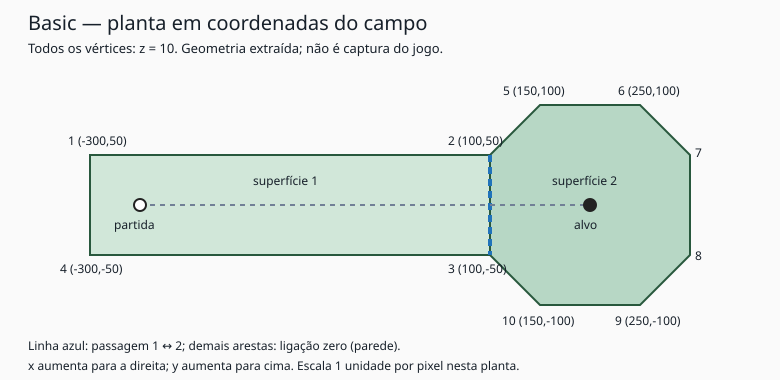

# Campo Basic e formato das tabelas

2026-10-28. Continuação somente leitura. A informação do usuário de que apenas help e MIDI são externos é compatível com os dados observados: recursos gráficos são carregados do módulo e a geometria abaixo é construída por instruções do próprio executável. Isso não equivale ainda a um inventário exaustivo de todas as dependências de arquivo.

## O que foi recuperado

O bloco inicial de `FUN_00404EDC`, de `0x00404EF3` a `0x0040543F`, inicializa o campo de índice 1, nome original **Basic**, string em `0x0048E5EB`. Após esse bloco, INC ESI passa ao índice 2, cujo nome e geometria serão tratados em outro incremento. Não foi necessário decompilar a rotina inteira de 19051 instruções.

**Confiança alta:** valores e offsets abaixo vêm de atribuições explícitas do bloco e da cópia para geometria de trabalho em `0x00420074`. Não houve leitura de um objeto vivo nem execução do jogo; alterações posteriores de campo ainda não foram rastreadas exaustivamente.

- 10 vértices e duas superfícies, todos com z=10.
- Partida: `(-250,0,10)`; alvo: `(200,0,10)`.
- Superfície inicial: 1. A tabela correspondente alimenta os estados dos jogadores em `0x0041FB40`, restaurados em `0x0041F0A0`.
- Valor 2 no parâmetro comparado a tacadas em outras rotinas: candidato forte a par.
- Outro parâmetro do campo vale 64; seu significado continua sem classificação.

| Vértice | x | y | z |
| --- | ---: | ---: | ---: |
| 1 | -300 | 50 | 10 |
| 2 | 100 | 50 | 10 |
| 3 | 100 | -50 | 10 |
| 4 | -300 | -50 | 10 |
| 5 | 150 | 100 | 10 |
| 6 | 250 | 100 | 10 |
| 7 | 300 | 50 | 10 |
| 8 | 300 | -50 | 10 |
| 9 | 250 | -100 | 10 |
| 10 | 150 | -100 | 10 |

| Superfície | Vértices na ordem original | Ligações por aresta |
| --- | --- | --- |
| 1 | 1,2,3,4 | 0,2,0,0 |
| 2 | 5,6,7,8,9,10,3,2 | 0,0,0,0,0,0,1,0 |

A ligação de cada posição se refere à aresta entre aquele vértice e o próximo, fechando o último no primeiro. Assim, a aresta 2→3 da superfície 1 liga à superfície 2, e a aresta 3→2 da superfície 2 devolve à 1. A extração validou reciprocidade e limites dos índices. As demais ligações valem zero e entram no tratamento de parede já observado na física.

O índice de superfície é relevante para colisões: não basta exportar apenas um contorno externo ou uma malha visual. Também é preciso preservar o polígono de suporte e suas ligações.

## Esquema recuperado das tabelas de origem

Seja `O` a base do objeto, `h` o índice de campo (Basic=1), `i` o índice de vértice começando em zero na fórmula de endereço, `s` a superfície começando em zero e `e` a posição da aresta começando em zero. Os valores de índices **armazenados** nos polígonos começam em 1.

| Conteúdo | Endereço relativo a O | Tipo |
| --- | --- | --- |
| x de vértice | `0x81BC0 + h*400 + i*4` | int32 |
| y de vértice | `0x85590 + h*400 + i*4` | int32 |
| z de vértice | `0x88F60 + h*400 + i*4` | int32 |
| quantidade de vértices | `0x9CD54 + h*4` | int32 |
| lista de vértices de superfície | `0x8C950 + h*1600 + s*32 + e*4` | int32 |
| quantidade de vértices da superfície | `0x9B070 + h*200 + s*4` | int32 |
| quantidade de superfícies | `0x9CDE8 + h*4` | int32 |
| superfície vizinha por aresta | `0x9CEA0 + h*3200 + s*32 + e*4` | int32 |
| alvo x/y/z | `0xC7ABC/0xC7B50/0xC7BE4 + h*4` | int32 |
| partida x/y/z | `0xC7C78/0xC7D0C/0xC7DA0 + h*4` | int32 |
| superfície inicial | `0xC7E34 + h*4` | int32 |
| parâmetro não classificado | `0xC7EC8 + h*4` | int32 |
| candidato a par | `0xC7F5C + h*4` | int32 |
| nome | `0xC7FF0 + h*4` | AnsiString construído pelo runtime |

Os strides sugerem reservas de 100 coordenadas, 50 superfícies e até oito posições por superfície; são inferências de capacidade, não contagens reais de todos os campos. A tabela de ligações tem stride de campo diferente da lista de vértices; não compactá-las supondo o mesmo layout binário.

Em `0x00420074`, os dados selecionados são copiados para arrays ativos a partir de `+0xB9D00/+0xBA020/+0xBA340`, e a lista de índices para `+0xBA680`. A física usa bases deslocadas por um elemento (`+0xB9CFC`, etc.), pois os IDs são de base 1. A função também constrói pontos deslocados em índices +100 e polígonos laterais para apresentação. Esses polígonos derivados não devem ser confundidos com superfícies físicas adicionais do campo original.

## Extração reproduzível

- [dados/basic.json](dados/basic.json): valores com endereço da instrução e offset do objeto para cada atribuição.
- [scripts/extract-basic.cjs](scripts/extract-basic.cjs): avalia somente MOV/LEA/ADD/SHL/XOR do primeiro bloco salvo pelo Ghidra. Não executa o binário nem abre o banco.
- [evidencias/campo-basic-ghidra.json](evidencias/campo-basic-ghidra.json): instruções, loader e projeção consultados.

Reprodução a partir da raiz do repositório: `node docs/scripts/extract-basic.cjs`. O script falha se encontrar instrução ou expressão não suportada, atribuição ausente, índice inválido ou ligação sem reciprocidade. Não usa um padrão de bytes para presumir instruções. O JSON representa o bloco identificado, não um dump completo de memória do jogo.

## Trajetórias de referência derivadas

Em Basic, ao longo de y=0, uma tacada hipotética com `vx=10`, `vy=vz=0`, partindo de x=-250, tem estes valores previstos pela integração observada:

| Passos | x | vx após amortecimento | Superfície |
| ---: | ---: | ---: | ---: |
| 1 | -240,0000 | 9,8000 | 1 |
| 25 | -51,7324 | 6,0346 | 1 |
| 50 | 67,9152 | 3,6417 | 1 |
| 60 | 101,2234 | 2,9755 | 2 |
| 100 | 183,6902 | 1,3262 | 2 |
| 107 | 192,4348 | 1,1513 | 2 |

No passo 107 satisfaz `abs(x-200)<8` e `abs(vx)<2`; com y e vy zerados, deve entrar no estado 3. Tempo nominal: 2,14 s. **Confiança média/alta como previsão**, pois os cálculos foram derivados em double, sem executar o original que armazena vários campos em float32. Não são medições nem testes de equivalência dinâmica.

Outro caso para validar um futuro port: em superfície 1, posição (-299,0,10), velocidade (-2,0,0), a integração tenta x=-301, atinge a parede x=-300, restaura x=-299 e deve devolver vx≈+1,96. O teste futuro deve observar também a ordem dos testes de aresta e as convenções angulares, em vez de apenas impor o resultado desejado.

Não há rampa em Basic. O próximo campo com variação de altura deverá fornecer a referência de rampa; extrapolar uma rampa inventada como dado deste campo seria incorreto.
