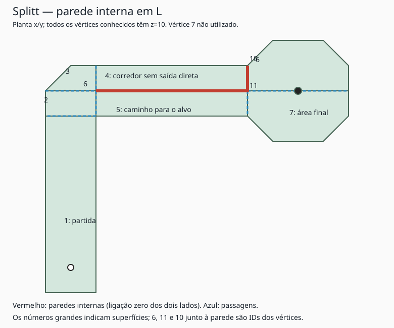

# Splitt: confirmação da parede em L

2026-10-28. A observação do usuário sobre uma parede interna em L foi usada como pista e confirmada nas tabelas extraídas. **A parede não depende do vértice 7 sem coordenadas.**

## Evidência geométrica

| Segmento | Vértices | Coordenadas | Lados e atribuições de ligação zero |
| --- | --- | --- | --- |
| Horizontal | 6↔11 | (-200,200,10) ↔ (100,200,10) | Superfície 4, aresta 3: `0x004126FC`; superfície 5, aresta 1: `0x00412726` |
| Vertical | 11↔10 | (100,200,10) ↔ (100,250,10) | Superfície 4, aresta 2: `0x004126DD`; superfície 6, aresta 5: `0x004127C9` |

Ambos os segmentos possuem geometria compartilhada entre dois polígonos, mas as ligações dos dois lados valem zero. `0x0041D2A4` trata ligação zero como parede: reflete direção e restaura posição anterior. As coordenadas e suas atribuições estão em [campo 25](dados/campos/25.json). **Confiança alta** na existência e classificação dessas paredes.

O vértice 7 não aparece em nenhum polígono. Os vértices 6, 11 e 10 são conhecidos e têm atribuições explícitas; não há razão para completar o slot 7 para reconstruir o L.

A superfície 4 só possui passagem para a 3. As superfícies 3 e 2 dão acesso ao caminho alternativo 2→5→7; portanto, o braço superior é um desvio sem saída direta para o alvo. Isso sustenta a observação de a bola ficar confinada nesse trecho. O grafo não mostra uma prisão topologicamente irreversível: existe caminho de volta por 4→3→2. A dificuldade concreta de retirar a bola e o comportamento nos cantos ainda dependem de validação dinâmica.

## Consequência para exportação e física

**Não remover arestas internas apenas por serem compartilhadas.** Um algoritmo que una todos os polígonos e mantenha somente o contorno externo apagaria a parede em L. O dado determinante é a ligação por aresta.

Uma posição também deve preservar seu índice de superfície. Em pontos sobre a fronteira interna, coordenadas isoladas não indicam de qual lado deve ser aplicado o tratamento de colisão. É especialmente relevante para checkpoints, replay e sincronização online.

## Auditoria dos demais campos

[scripts/analyze-internal-walls.cjs](scripts/analyze-internal-walls.cjs) agrupa arestas pelos IDs dos vértices e identifica pares inversos com ligação zero nos dois lados. Resultado em [dados/arestas-internas.json](dados/arestas-internas.json):

| Campo | Pares de arestas desse tipo |
| --- | ---: |
| 13 — Pyramid | 3 |
| 25 — Splitt | 2 |
| 28 — Side | 2 |
| 34 — Walls | 3 |
| 36 — Maze | 9 |

Esta auditoria é estrutural: identifica arestas compartilhadas pelos mesmos IDs. Não procura segmentos apenas parcialmente sobrepostos nem pontos coincidentes com IDs diferentes. Nenhuma geometria foi reparada. O fato de haver paredes internas também em campos com rampa reforça que elas precisam fazer parte do modelo físico exportado.
