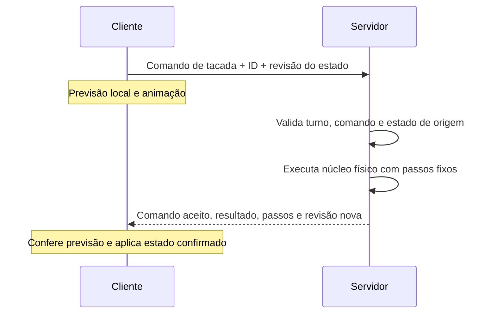

# Proposta futura: servidor autoritativo por tacada

2026-10-28. Direção sugerida pelo usuário: cliente envia o vetor de puxada, servidor simula a tacada e confirma o resultado; cliente pode antecipar a animação. **Este documento é uma proposta para a reconstrução**, não comportamento atribuído ao Winigolf original. Nenhuma infraestrutura online foi implementada ou contratada.

## Modelo adequado ao jogo

Para partidas por turnos, o fluxo proposto é viável: o servidor mantém o estado verdadeiro e calcula as consequências de cada comando. O cliente mostra uma previsão e aplica a confirmação recebida. O servidor pode simular os passos sem esperar 20 ms de relógio por passo; a animação reproduz a sequência com o tempo visual apropriado. Não foi medido ainda quanto custa simular uma tacada.



## Enviar um comando independente da câmera

O vetor em pixels depende da escala, orientação da câmera, modo de botão e limites de arraste. A interface deve convertê-lo para um **comando canônico de mira/força em coordenadas do campo**, com precisão e limites definidos pelo protocolo. Isso pode preservar a sensação de clicar e puxar sem obrigar o servidor a reproduzir a interface VCL.

Proposta inicial de conteúdo, ainda sem valores fechados de quantização:

```text
ShotCommand:
    shotId                 identificador único do comando
    expectedStateRevision  revisão autoritativa usada pelo cliente
    aimX, aimY             componentes canônicas quantizadas
    shotMode               modo de tacada, se ambos forem mantidos
    physicsVersion         versão das regras numéricas
    courseDataVersion      versão dos dados do campo
```

A origem da bola, jogador ativo, campo e superfície vêm do estado do servidor. O cliente não escolhe uma posição inicial arbitrária. O servidor verifica limites dos componentes/força, estado de repouso, turno, revisão e repetição de shotId; um comando retransmitido deve devolver a mesma decisão, sem contar outra tacada.

Pode-se escolher transmitir direção e força em vez de componentes; o ponto importante é que a conversão para impulso seja única, versionada e independente de pixels/câmera. Não enviar simultaneamente força e impulso conflitantes sem definir qual é a representação canônica. O servidor valida o comando e calcula o impulso; não aceita como verdade um resultado físico calculado pelo cliente.

## Resultado e estado necessários

O retorno não deve conter apenas coordenadas finais. A descoberta de Splitt mostra por que a **superfície física atual** precisa ser preservada. Um resultado confirmado deve incluir:

- posição e superfície finais; velocidade caso não seja um término em repouso;
- motivo do término: parada, captura, penalidade ou proteção por limite de simulação;
- contagem de tacadas, pontuação e próximo jogador/campo;
- número de passos, revisão do estado e versão da física/dados;
- estado adicional exigido por futuras mecânicas, caso sejam confirmadas.

Para retomar uma simulação no meio da tacada, também são necessários os estados que afetam o próximo passo: velocidade, superfície, contadores e flags relevantes. Um checkpoint completo é diferente de uma simples posição visual. No original há posição anterior e contagem de rebotes; o novo núcleo deve explicitar seu estado em tipos próprios, sem copiar o layout do formulário.

O resultado pode chegar enquanto a previsão ainda está animando. Registrar o número do passo permite casar os tempos sem aplicar um salto visual imediatamente. Se houver divergência importante perto de uma parede ou do buraco, a confirmação precisa prevalecer; suavizar só a imagem não deve alterar o estado oficial.

## Determinismo é requisito de implementação

Mesma intenção de tacada e mesmas fórmulas matemáticas não bastam para garantir resultados idênticos bit a bit entre qualquer cliente e servidor. Por exemplo, a documentação de `System.Math.Sin` informa que resultados exatos podem variar entre sistemas operacionais e arquiteturas devido ao runtime C subjacente. [Microsoft: Math.Sin](https://learn.microsoft.com/en-us/dotnet/api/system.math.sin?view=net-10.0).

Essa diferença é relevante aqui: comparações próximas de zero, cantos e limites de captura podem escolher ramos diferentes. O original usa x87 e gravações em float32. Não é necessário reproduzir isso exatamente; é necessário definir as regras numéricas da **nova** implementação e aplicá-las consistentemente.

Requisitos propostos para o núcleo:

1. Passo físico fixo nominal de 20 ms, com ordem explícita das operações e desempate de colisões. Renderização não controla o número de passos.
2. Dados de campo versionados, ordenação estável de superfícies/arestas e regras claras para pontos sobre fronteiras.
3. Entrada quantizada e tratamento definido para vetor zero, valores inválidos e limites de força.
4. Nenhuma dependência de áudio, câmera, FPS ou relógio na física. A dependência legada do contador de colisões no som deve ser removida intencionalmente.
5. Aleatoriedade física, se vier a existir, usa gerador e seed definidos no estado. Sorteio de campos/turnos é decidido pelo servidor; animação de câmera não consome o gerador físico.
6. Limite explícito de passos por tacada e resultado definido caso não termine, cobrindo oscilações em rampas e aprisionamento. Valor do limite ainda será escolhido com testes.

Há duas estratégias razoáveis:

- **Primeiro protótipo:** mesmo núcleo C# compartilhado, servidor autoritativo, previsão em ponto flutuante e reconciliação. Medir divergências nas plataformas pretendidas; aceitar que previsão é aproximada até haver evidência contrária.
- **Replays idênticos entre plataformas:** adotar representação numérica e operações determinísticas, por exemplo ponto fixo com regras de arredondamento, overflow e funções matemáticas explicitamente definidas. Ponto fixo sozinho não resolve ordenação de colisões, entradas ou aleatoriedade.

Para este projeto, a primeira estratégia permite priorizar a sensação do original. Caso o requisito futuro exija igualdade estrita, a política numérica deve ser fechada antes de estabilizar replays ou partidas persistidas. Uma biblioteca compartilhada reduz duplicação de regras, mas sozinha não prova igualdade entre plataformas.

Se a previsão divergir muito em cantos, o servidor também pode devolver amostras da trajetória ou eventos com número do passo para os clientes reproduzirem a jogada confirmada. É uma alternativa de apresentação que preserva a autoridade do servidor sem exigir igualdade numérica em todo cliente. Frequência e formato dessas amostras ficam para testes de rede.

## Validação futura

Uma suíte útil deve reproduzir comandos gravados em vários cenários: plano Basic; descida, reversão e subida em Dip; parede em L de Splitt; cantos e corredores de Maze; captura lenta/rápida; sétima tacada e penalidade. Comparar estados por passo, motivo de término e pontuação, além da posição final. Repetir entre plataformas somente quando houver implementações concretas a comparar.

Nenhum teste de determinismo entre plataformas nem protótipo de rede foi realizado nesta etapa. O estudo do original continua fornecendo parâmetros e casos; esta proposta define como evitar que detalhes da interface antiga contaminem a futura simulação de servidor.
