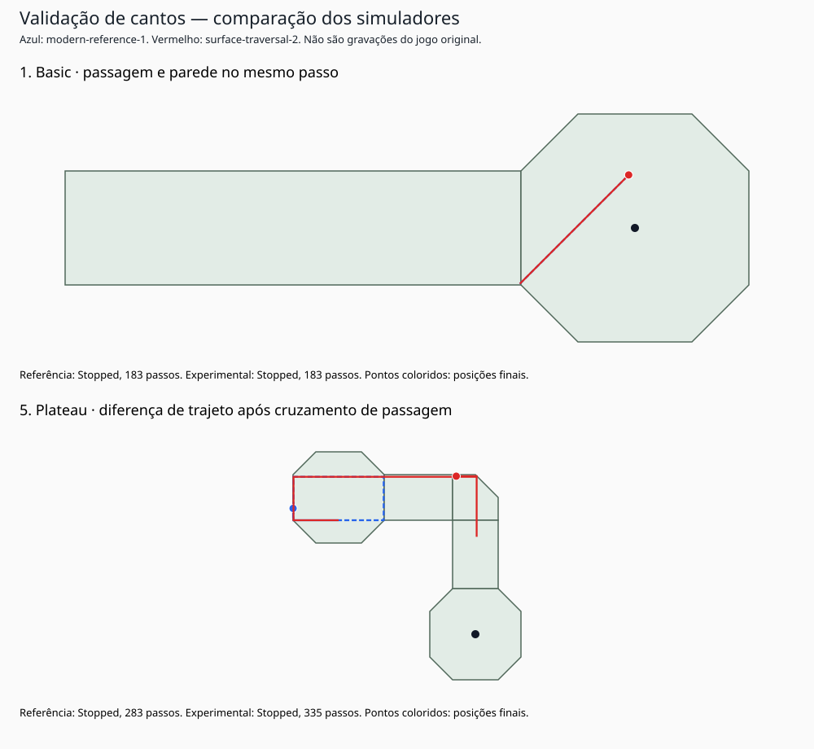

# Validação de cantos e travessia de superfícies

2026-10-28. Esta etapa valida e compara **dois perfis do novo simulador**, sem executar o jogo original e sem modificar seu binário ou banco Ghidra.

## Causa dos diagnósticos anteriores

O assembly de `0x0041D2A4` foi reconferido. A superfície pendente é gravada em `0x0041D6CA`; as paredes restauram posição em `0x0041D694–0x0041D6B2`, sem limpar essa superfície; a troca é aplicada depois do loop. O perfil `modern-reference-1` preserva essa ordem estática, embora já tenha simplificações numéricas explicitadas nos documentos anteriores.

Dois problemas reproduzidos:

1. Uma passagem é selecionada, depois uma parede restaura a posição, mas a superfície vizinha permanece. Caso mínimo em Basic: posição (99,-49,10), superfície 1, velocidade (2,-2,0).
2. O endpoint cruza uma passagem e ultrapassa outra borda do vizinho no mesmo passo. O perfil antigo só passa a testar o vizinho no próximo passo.

Existe ainda efeito sem estado fora do polígono: o teste do endpoint pode apontar para o lado externo da extensão de uma parede da superfície antiga **depois** de o caminho já ter cruzado uma passagem. Em Plateau, posição (-51,195,100), superfície 1, velocidade (7,0,0), o deslocamento cruza o portal em x=-50 antes de alcançar a extensão da aresta diagonal. A referência percorre as arestas em ordem e rebate na diagonal; isso não é colisão com o segmento de parede efetivamente percorrido. A política nova continua pelo portal para a superfície 2.

Esses são resultados do algoritmo de referência e da geometria recuperada. A análise estática sustenta a relação com o código original, mas **não prova que o original, com seus arredondamentos x87 e entrada real, produz a mesma trajetória completa**.

## Perfil experimental surface-traversal-2

Implementado como opção, mantendo `reference` como padrão e preservando a versão anterior para comparação:

- Mesmo impulso, passo de 20 ms, aceleração inicial da superfície e amortecimento 0,98.
- Segue o segmento de deslocamento tentado pelos polígonos convexos e suas passagens explícitas.
- Calcula a primeira saída geométrica de cada superfície; continua no vizinho no mesmo deslocamento, podendo atravessar várias passagens.
- Se encontra parede, reflete a velocidade já amortecida e restaura **posição e superfície de origem** do passo. Não usa tempo restante do deslocamento para avançar após o rebote.
- Em empate de contato entre parede e passagem, parede tem prioridade. Paredes simultâneas são refletidas em ordem de índice, apenas quando a velocidade aponta para fora. Isso muda o caso de canto duplo da referência.
- Não procura outro polígono globalmente nem ignora paredes internas para consertar uma posição. O L de Splitt permanece sólido.
- Usa tolerâncias explícitas de fração do segmento (1e-10) e distância à reta (1e-9). São decisões numéricas modernas, não constantes recuperadas.
- Detecta travessia repetida, limite interno ou endpoint não resolvido e retorna `GeometryResolutionFailed`, com rollback e evento diagnóstico, em vez de inventar uma superfície. Esse motivo não conta como repouso/captura/penalidade automática.

É uma modernização deliberada, não uma alegação de reconstrução exata. Ainda não foi promovida a padrão.

## Verificações e resultados

**92/92 verificações aprovadas** para os dois perfis: [verification-v2.json](../artifacts/simulator/verification-v2.json). Incluem:

- Casos analíticos anteriores, sem apagar o teste que documenta a inconsistência legada.
- Canto com duas paredes, parede/portal em empate, parede interna em ambos os braços do L de Splitt e sua saída válida.
- Três passagens em um deslocamento; parede encontrada no vizinho, com rollback correto para a origem.
- Caso reduzido de Plateau; chegada exata ao portal e movimento seguinte sem ping-pong artificial.
- Captura de Basic ainda no passo 107; equações de plano/rampa e penalidade preservadas nos casos definidos.
- Checkpoints serializados em JSON a 25%, 50% e 75% de uma tacada de Maze, retomados passo a passo em ambos os perfis, com estados iguais aos da execução contínua **no mesmo runtime**. Isso não comprova determinismo entre plataformas.

Uma auditoria adicional executou **214.320 testes de um passo**, sem falhas: [geometry-probes-v2.json](../artifacts/simulator/geometry-probes-v2.json). Usa todas as 265 superfícies, centro, pontos próximos de vértices e arestas, 16 direções e módulos 0,001/2,5/15/30/300. O módulo 300 é estresse geométrico, não força de tacada reivindicada para a interface original. Confere estado finito, pertença à superfície final, resolução e preservação do módulo já acelerado/amortecido nas reflexões. Não testa trajetórias longas em todos esses pontos.

## Mesmas 864 tacadas, dois perfis

| Métrica | modern-reference-1 | surface-traversal-2 |
| --- | ---: | ---: |
| Tacadas | 864 | 864 |
| Erros de execução | 0 | 0 |
| Falhas de resolução geométrica | 0 | 0 |
| Limites de 6000 passos atingidos | 0 | 0 |
| Trajetórias com posição fora da superfície selecionada | 111 | **0** |
| Capturas | 16 | 16 |
| Paradas | 848 | 848 |

Os motivos de término coincidiram tacada a tacada nesta bateria, mas **214 posições finais diferem mais de 1e-6 unidade**, e 92 contagens de passos diferem. A maior diferença de posição final é aproximadamente 368,25 unidades, em Plateau. Portanto, eliminar inconsistências geométricas não significa preservar perfeitamente a sensação ou o resultado de toda tacada.

Relatórios: [referência](../artifacts/simulator/sweep-reference-v1.json), [experimental](../artifacts/simulator/sweep-traversal-v2.json), [comparação](../artifacts/simulator/comparison-v1-v2.json). A comparação verifica igualdade dos impulsos, IDs e hashes dos dados antes de comparar resultados.



No exemplo de Basic, as posições finais quase coincidem, embora o estado intermediário esteja errado na referência. Em Plateau, a divergência cresce após colisões/passagens. Ambos os tipos precisam ser considerados: comparar só posição final esconderia o primeiro; comparar só contenção esconderia a mudança de jogabilidade do segundo.

## Reproduzir e próximos passos

```powershell
dotnet run --project simulator/src/Winigolf.Simulator -- verify --output artifacts/simulator/verification-v2.json
dotnet run --project simulator/src/Winigolf.Simulator -- audit --output artifacts/simulator/geometry-probes-v2.json
dotnet run --project simulator/src/Winigolf.Simulator -- sweep --profile reference --max-steps 6000 --output artifacts/simulator/sweep-reference-v1.json
dotnet run --project simulator/src/Winigolf.Simulator -- sweep --profile traversal --max-steps 6000 --output artifacts/simulator/sweep-traversal-v2.json
node docs/scripts/compare-simulator-profiles.cjs
```

A base está mais bem verificada para iniciar uma **visualização interativa de depuração** com seleção de campo, puxada, pausa e passo a passo, usando o núcleo existente. A prioridade será comparar Basic, Dip, Splitt e Plateau com o jogo original, escolher a política desejada e calibrar força/feeling. Não é necessário começar por menus completos ou rede.

Não foram medidos movimentos no original nem testada igualdade entre máquinas. A conclusão desta etapa é consistência estrutural do perfil experimental nos casos executados, não fidelidade dinâmica comprovada.
