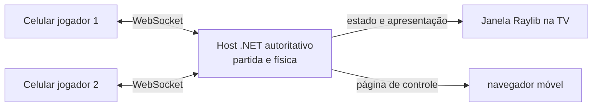

# Multiplayer presencial com celulares e tela grande

2026-10-31. Direção aprovada pelo usuário: a partida aparece numa tela grande; cada participante entra pelo navegador do celular, mira arrastando e confirma a tacada num botão. Um servidor autoritativo executa as regras e a física. O primeiro protótipo foi implementado em `Winigolf.Game` com host .NET, página móvel e WebSocket; ainda requer validação numa rede com dois dispositivos.

## Experiência alvo

Uma máquina ligada à TV executa o cliente Raylib e, inicialmente, também hospeda o servidor e a página web dos celulares. Os jogadores entram pela mesma rede local usando um QR code ou endereço/código curto. A TV apresenta campo, bolas, corda de mira, animação da tacada, turnos e placar. O celular apresenta nome/cor, estado da conexão, uma área simples de mira e o botão **Confirmar tacada**.

O processo da TV mantém a partida e chama o núcleo `Winigolf.Physics`. No futuro, o servidor pode sair da máquina da TV e ela passa a ser apenas mais um cliente; a autoridade e as mensagens permanecem as mesmas.

## Referencial da tacada

O servidor escolhe e mantém a orientação de câmera usada durante o turno. Antes de liberar a tacada, envia esse `cameraYaw` aos controles conectados. O ângulo enviado pelo celular é **relativo a essa câmera**, não uma direção absoluta independente da vista. Mantemos a convenção acertada: ângulo inteiro de 0 a 359 graus, 0° no oeste do referencial e aumento anti-horário. A conversão desse ângulo relativo para os eixos do campo deve ser feita uma única vez no host; o sinal e a base precisam ser conferidos contra a transformação existente em `SceneCamera`/`Aim` durante a implementação.

A força permanece inteira de 1% a 100%; cada ponto percentual corresponde às 2,5 unidades de puxada já escolhidas. Isso só quantiza a intenção do jogador. A física não muda: o host converte ângulo e força ao impulso aceito pelo simulador, respeitando a curva de mira atual. A definição exata da função de conversão será compartilhada pelo host e pela UI, sem aceitar do telefone posição, velocidade ou estado físico arbitrário.

O `cameraYaw` é estado de apresentação decidido pelo host. Todos recebem o mesmo valor para que a mesma intenção relativa aponte para a mesma direção na TV. A semente/decisão do giro não deve depender da aleatoriedade do cliente nem afetar a simulação física.

## Ciclo de uma jogada

1. O host abre a sala. Os celulares entram, escolhem nome e recebem ID e cor atribuídos pelo host. O host inicia a partida quando os participantes estiverem prontos.
2. O host envia um snapshot com campo, hash dos dados, política e versão da física, jogadores, placar, jogador ativo, revisão do estado e orientação da câmera.
3. Durante o arraste, o celular envia prévias de ângulo/força. O servidor aceita-as apenas para o jogador ativo e retransmite a prévia mais recente para a TV. Essas mensagens não alteram a partida.
4. Ao tocar em **Confirmar**, o celular envia um comando imutável identificado por `shotId` e pela revisão que usou. O host verifica turno, revisão, faixa de valores e duplicação.
5. O host converte a entrada em impulso e executa `GameSession.Shoot`/`Simulator.Run`. A animação da TV reproduz os frames calculados pela autoridade; ao terminar, o host atualiza tacadas, penalidades, placar e próximo turno.
6. O host publica o novo snapshot/revisão. Pré-visualizações antigas e comandos atrasados são descartados.

A física atual pré-calcula a trajetória; portanto, o render pode animar os frames sem esperar que cada passo físico transcorra na rede. Na primeira versão, os telefones podem receber placar/estado e assistir à animação na TV; não é necessário enviar todos os frames da trajetória pela rede para validar a experiência principal.

## Mensagens iniciais

Formato sugerido: JSON sobre WebSocket, com um objeto por mensagem. O protocolo leva um número de versão e limita o tamanho e a frequência de entrada.

| Mensagem | Direção | Conteúdo essencial |
|---|---|---|
| `Join` | telefone → host | versão do protocolo, nome, código da sala |
| `Joined` | host → telefone | `playerId`, cor, estado da sala e capacidade |
| `MatchSnapshot` | host → todos | revisão, campo/hash, regras/versão física, jogador ativo, bolas, tacadas, placar e `cameraYaw` |
| `AimPreview` | telefone → host | revisão, sequência, ângulo relativo e força percentual |
| `AimPreview` | host → TV/todos | identidade/cor do jogador e prévia validada mais recente |
| `ShotCommit` | telefone → host | `shotId`, revisão, ângulo e força confirmados |
| `ShotAccepted` | host → todos | `shotId`, jogador, entrada canônica, versão física e revisão resultante |
| `ShotRejected` | host → telefone | `shotId` e motivo legível: vez incorreta, revisão antiga ou entrada inválida |
| `TurnChanged` | host → todos | próximo jogador e sua nova orientação de câmera |

Cada comando confirmado é idempotente: repetir o mesmo `shotId` devolve a decisão original e nunca cria uma tacada adicional. Jogador ativo, posição inicial, superfície, pontuação e resultado vêm do estado mantido pelo host.

## Arquitetura incremental

1. **Protocolo e conversão canônica — implementado:** mensagens validadas, entrada independente de pixels e ângulo relativo à câmera.
2. **Sala local — implementada:** WebSocket no processo da TV, página móvel mínima, cadastro e início de partida. O endereço aparece na tela; ainda não há QR code. Uma fila thread-safe leva comandos até o loop Raylib.
3. **Vertical slice — implementado, validação pendente:** suporta até seis navegadores, mostra nomes/cores, prévia da corda na TV, confirmação, simulação e estado do placar/turno. Falta experimentar com dois dispositivos na rede real.
4. **Robustez futura:** tratamento/aviso para jogador que não retorne, controle de sala e seleção de pista. Depois avaliar hospedagem pública, NAT, contas ou matchmaking.

O protótipo usa `System.Net.WebSockets`/ASP.NET Core sem framework de jogo/rede dedicado. As chamadas Raylib continuam na thread que criou a janela. O host web e o cliente visual estão no mesmo processo WinExe.

## O que ainda precisa de decisão/teste

- Validar em jogo que 0°/90°/180°/270° acompanham os quatro lados da câmera, inclusive depois de uma virada; a conversão está implementada, mas não foi testada em dispositivos.
- Conferir visualmente a intensidade de 1% e 100% pela página móvel com a curva de mira atual.
- Definir o que acontece se um jogador não retornar, além de seleção de pista e controle de sala. A reconexão pelo mesmo navegador já restaura o assento.
- Testar navegadores móveis reais, descoberta de endereço/QR e regras de firewall do Windows na LAN.
- A física usa `double` e funções matemáticas de runtime; a igualdade bit a bit entre arquiteturas não está garantida. Isso não bloqueia o primeiro protótipo porque o host calcula o resultado oficial. Se houver previsão local no telefone, ela é apenas visual e o estado final do servidor prevalece.

## Estado e limites do protótipo

Inicie com `dotnet run --project simulator/src/Winigolf.Game` e abra o endereço mostrado na janela em navegadores na mesma LAN. O servidor entrega a página, cria uma sala, aceita até seis jogadores, transmite prévias de mira e recebe tacadas confirmadas. Somente o primeiro jogador que entrar recebe o botão para começar; o servidor também valida essa permissão. O loop Raylib aplica a tacada na sessão ativa e calcula a trajetória no host. A tela grande destaca o nome do jogador da vez na cor da bola e coloca etiquetas menores sobre as bolas dos demais. Em jogo local e online, cada captura segura a vez por 2 segundos, ou 3 segundos abaixo do par para acomodar o aplauso mais longo. A captura final usa essa mesma espera e então avança de campo, sem atraso duplicado. Tempos, modo e porta são opções da instância `GameConfig`, passada aos componentes; ela pode ser preenchida por `IConfiguration` futuramente.

O servidor e a janela Raylib ficam no mesmo processo, mas a implementação mantém o recebimento de rede separado numa fila consumida pelo loop principal. A autoridade continua sendo `LocalMatch`/`GameSession` no host. A força enviada é inteira de 1% a 100%, convertida em unidades de puxada pela regra de 2,5 unidades por percentual; o ângulo relativo gira com `Camera.Yaw`, com 0° no oeste e crescimento anti-horário. O host converte isso de volta para a mira equivalente e usa o simulador existente.

O navegador salva o nome e um token aleatório de retomada no `localStorage`, separados por endereço/porta do host. Ao recarregar ou reabrir a página na mesma sala, ele entra automaticamente com o mesmo jogador e recebe o estado atual; a retomada substitui a conexão antiga desse assento. O token só vale durante a vida da sala em memória. Se o servidor reiniciar, o ID da sala muda e o navegador pede uma nova entrada com o nome já preenchido. Se o jogador ativo desconectar, a partida espera sua reconexão e não avança sozinha. As prévias de mira recebidas pelo host são suavizadas na apresentação da TV (`GameConfig.RemoteAimSmoothingPerSecond`); os valores quantizados enviados ao confirmar a tacada não são alterados.

Ainda não foi testada a reconexão em vários dispositivos reais. Não há QR code, gestão de abandono, autenticação ou hospedagem pública. As versões de cliente e servidor devem corresponder. Não houve alteração no executável original nem no banco Ghidra.
